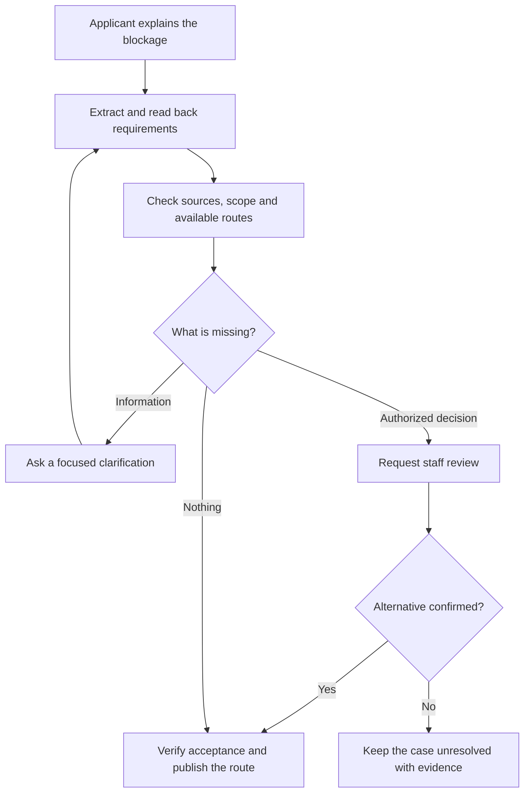

# RuleCollision

> A voice AI agent that identifies incompatible administrative requirements and helps people obtain a confirmed way forward.

**Document type:** Project concept and MVP specification  
**Status:** Proposed design; product demand and technical effectiveness still require validation  
**Prepared:** 8 November 2026  
**Initial scope:** One cooperating institution, two or three administrative processes, and a small group of authorized staff

## 1. The idea in plain English

RuleCollision helps when a person receives instructions from different offices that cannot all be followed in the stated order.

For example:

> Office A says: “Bring the certificate from Office B before we issue your clearance.”  
> Office B says: “Bring the clearance from Office A before we issue your certificate.”

The person understands both instructions. The difficulty is that neither process can start.

RuleCollision listens to the instructions, identifies what is blocking progress, and asks the specific clarification that could unlock a legitimate route. It might discover that one office accepts a provisional document, that the two offices mean different things by “clearance,” or that the matter needs an authorized decision.

The intended outcome is one of three things:

1. A confirmed sequence the applicant can follow.
2. A precise clarification request directed to the right person.
3. An explicit unresolved case, with the conflicting requirements and their sources clearly documented.

The agent cannot create an exception, issue a certificate, or grant permission. Its job is to make the problem understandable and support an authorized resolution.

## 2. The real-world problem

Administrative processes can involve different teams, documents, deadlines and interpretations. An applicant may encounter:

- Prerequisites that depend on each other.
- Different names for the same document.
- Similar names for different documents.
- An old instruction that conflicts with a newer procedure.
- A requirement that applies only to a particular applicant category.
- A staff member who can describe a process but cannot approve an exception.

A research paper on bureaucratic indecision in India discusses coordination failures and contradictory rules among the factors affecting administrative decisions. This supports investigating the problem; it does not prove that this proposed product will solve it. [1]

The product hypothesis is that some repeated referrals can be avoided by establishing the exact requirements and asking a better clarification question.

### Initial users and customer

| Role | Need | Proposed benefit |
| --- | --- | --- |
| Applicant | Understand why the application cannot progress | A clear explanation and a verified next step |
| Service-desk employee | Understand a case without reconstructing every conversation | A concise, source-linked account of the blockage |
| Authorized process owner | Decide whether an alternative procedure applies | A specific question with the relevant evidence |
| Institution | Reduce repeated referrals and inconsistent instructions | Visibility into recurring process problems |

Start with an institution willing to participate. An independent consumer app cannot guarantee that outside offices will respond or accept its recommendations.

## 3. A complete example

**Everything in this example is fictional. It is not a description of an actual university policy.**

A student needs a final clearance from an Accounts Desk and a completion certificate from an Academic Desk.

| Desk | Reported requirement |
| --- | --- |
| Accounts | A completion certificate is required before final clearance can be issued |
| Academic | Final clearance is required before a completion certificate can be issued |

The student has neither document.

### Step 1: Capture what was actually said

The student explains the situation by voice.

> **Student:** “Accounts told me to get the completion certificate first. Academic says they need the clearance from Accounts.”

The agent asks for the exact document names, the dates of the instructions and any supporting messages. It distinguishes the student's recollection from a direct staff statement or a written rule.

### Step 2: Check whether the conflict is real

> **Agent:** “Did Academic say final clearance, or would a receipt showing that you applied for clearance be sufficient?”

This question tests a possible misunderstanding. It does not imply that a receipt is accepted.

The student confirms that both desks explicitly requested the final documents. That remains an applicant-reported claim until staff or approved records verify it.

### Step 3: Explain the blockage

> **Agent:** “Under the requirements currently recorded, each final document needs the other one first. I have not yet found a confirmed starting step.”

The agent displays both requirements with their sources. It also checks whether an existing alternative or already-held document makes the process possible.

### Step 4: Prepare a targeted clarification

The agent proposes a question for the institution's designated process owner:

> “Does an approved provisional document or joint processing route apply to this case? If so, which desk can initiate it, and what conditions must be met?”

If an approved policy already names a specific alternative, the question can reference it. Otherwise, the agent keeps the wording exploratory.

### Step 5: Record an authorized answer

In this fictional example, an authenticated process owner confirms that Accounts may issue a provisional clearance for this particular case. Academic separately confirms that it will accept that document.

The system records the approval scope, conditions, responsible role, expiry if any, and the evidence supporting acceptance by both desks.

### Step 6: Produce the route

1. Request the approved provisional clearance from Accounts.
2. Submit it to Academic to obtain the completion certificate.
3. Present the completion certificate to Accounts for final clearance.

This is marked **route confirmed** only after the required approvals and acceptance checks are complete. It becomes **completed** only when completion evidence is recorded.

If no alternative is approved, the case remains unresolved. The system provides the evidence and identifies the decision that is still needed.

## 4. Why voice belongs in this product

Voice is useful when people need to reconstruct conversations, describe exceptions or clarify terminology without filling in a complicated form.

The agent can immediately ask:

- “Was that required before applying, or before collection?”
- “Did they say both documents, or either one?”
- “Was that instruction for all applicants or only for your case?”
- “Who can confirm whether this alternative is accepted?”

Those small distinctions can change the dependency structure.

A text interface should remain available. Documents and authenticated staff confirmations still matter. Voice is the interaction channel for gathering and clarifying requirements; it is not evidence that a requirement is authoritative.

For a Malayalam and English pilot, preserve original terms alongside any translation. Read back document names, dates, conditions and negations before using them in the case model.

## 5. How it differs from nearby tools

| Tool or approach | Typical purpose | RuleCollision's proposed focus |
| --- | --- | --- |
| Task tracker | Record tasks, owners and progress | Determine why the stated prerequisites prevent progress |
| Meeting or call summarizer | Capture what participants said | Convert relevant statements into source-linked conditions and test their compatibility |
| FAQ or document chatbot | Answer questions from reference material | Compare requirements across offices within one specific case |
| Workflow planner | Order actions using known dependencies | Identify where no executable route is established and request the missing clarification |
| Follow-up calling agent | Ask for updates or reminders | Ask a targeted question whose answer changes whether a route is possible |

Dependency graphs and administrative action planners already exist. The public *Bureaucracy Action Agent* project describes document extraction, prerequisites, combined cases and next-action planning. Those features alone are not a novel contribution. [2]

The proposed distinction is the combination of:

- Cross-office spoken requirement clarification.
- An evidence-backed explanation of a procedural blockage.
- Targeted questions about an authorized alternative.
- Confirmation that each affected office accepts the resulting route.

**Novelty status:** This is an invention candidate, not a verified world-first or a patentability claim. The exact combination was not found in the public material reviewed for the idea, but undiscovered or unpublished prior work may exist.

## 6. The reasoning the system must get right

A dependency cycle and a logical contradiction are different problems.

“Obtain A before B” and “obtain B before A” may create an operational deadlock when neither exists and no alternative is available. They are not automatically a contradiction in formal logic. Joint issuance or a valid alternative could make the process feasible.

| Situation | Example | Correct behavior |
| --- | --- | --- |
| Circular prerequisites | A requires B; B requires A | Check initial documents, alternatives and possible joint processing |
| Incompatible conditions | The same accepted document must satisfy mutually exclusive conditions in the same context | Verify interpretation, scope and source before flagging a conflict |
| Missing information | The applicant does not know whether a receipt is accepted | Ask a clarification; do not label it a contradiction |
| Terminology mismatch | Two desks use different names for one document | Confirm equivalence with an authoritative source |
| Version mismatch | A staff instruction refers to an outdated procedure | Establish which rule version applies |
| Valid alternative | A requires either B or C, and the applicant has C | Show the available route; do not report a deadlock |

The first implementation should support a limited rule language: required documents, “all of” versus “any of,” applicant categories, existing documents and effective dates.

Use model-generated extraction to propose structured requirements. Use deterministic checks for schema validity and route analysis. Any formal result is conditional on the completeness and accuracy of the encoded rules.

Do not describe a result as the “smallest conflicting set” unless the implementation actually computes and verifies that property. An explainable blocking group is sufficient for the MVP.

## 7. Main workflow



After a route is published, record whether it was accepted in practice. A suggested plan, an approved route and a completed case are separate states.

## 8. MVP scope

### Include in the first version

- A browser voice session and text fallback.
- One cooperating institution and two or three approved processes.
- Applicant intake and staff clarification sessions.
- A small, manually reviewed rule collection.
- Requirement extraction with source references.
- Detection of circular prerequisites and missing information within the supported rule language.
- A staff screen to correct requirements and approve case-specific alternatives.
- A route summary showing conditions, responsible desks and supporting evidence.
- An unresolved-case report when the system cannot establish a route.
- A persistent case record that survives a disconnected call.

### Defer until the pilot shows value

- Public outbound calling to unrelated offices.
- Government-wide or country-wide process coverage.
- Automatic submission of applications or appeals.
- Large-scale policy crawling.
- Automated interpretation of complex legal provisions.
- General claims that the agent can resolve every administrative dispute.

For the pilot, participating staff can join through an authenticated link. This makes identity and authority easier to establish than an unrestricted phone-call system.

## 9. Suggested architecture

Use one voice agent and a small backend initially. Separate responsibilities in code without creating a large collection of independently acting agents.

| Component | Proposed choice | Responsibility |
| --- | --- | --- |
| Web interface | React | Applicant session, corrections, evidence view and staff decisions |
| Voice transport | LiveKit with a Python agent | Realtime audio, interruptions and participant sessions |
| Speech pipeline | Streaming STT, LLM and TTS | Conversation and structured candidate extraction |
| Application backend | Python and FastAPI | Authentication, cases, evidence, reviews and route APIs |
| Workflow controller | Explicit Python state machine; LangGraph if useful | Pause, resume and coordinate review-dependent steps |
| Rule engine | Deterministic Python functions | Evaluate prerequisites, alternatives and reachable actions |
| Primary database | PostgreSQL | Cases, rule versions, evidence metadata and decisions |
| File storage | Private object storage | Uploaded documents and consented recordings |
| Deployment | Docker with CI checks | Reproducible API and worker deployment |

LiveKit documents a realtime voice-agent framework with media transport and speech-pipeline support. LangGraph documents stateful execution, persistence and human review; FastAPI documents WebSocket support for application events. These are implementation options, not requirements of the concept. [3][4][5]

A cascaded speech pipeline is a reasonable starting design because transcripts can be inspected during extraction. A speech-to-speech model could be evaluated later, provided the same evidence and confirmation boundaries remain available.

### Keep durable case state outside the conversation window

Store confirmed facts, unresolved questions and rule versions in the database. Conversation summaries can help the agent speak naturally, but they must not become the authoritative record.

When a speaker interrupts:

1. Stop playback.
2. Capture the correction.
3. Reconfirm the affected requirement.
4. Save the updated version.
5. Recompute the route and mark dependent conclusions stale if necessary.

A partial transcript must not silently change a confirmed requirement.

## 10. Data model

| Entity | Essential information |
| --- | --- |
| Case | Applicant reference, institution, goal, current status and existing documents |
| Requirement | Issuing office, action, prerequisites, alternatives, conditions and applicability |
| Evidence | Source type, speaker or document, timestamp or page, original wording and verification status |
| Authority | Authenticated staff identity, role and permitted decision scope |
| Decision | Approval or refusal, case scope, conditions, approver, evidence and validity |
| Route | Ordered actions, rule and decision versions used, unresolved assumptions and confirmation status |

Example extracted requirement, using synthetic identifiers:

```json
{
  "requirement_id": "demo_req_01",
  "case_id": "demo_case_01",
  "issuing_office": "Accounts",
  "action": "issue_final_clearance",
  "prerequisite_expression": {
    "all_of": ["completion_certificate_issued"]
  },
  "applicability": {
    "process": "demo_student_exit",
    "applicant_category": "unknown"
  },
  "source": {
    "kind": "applicant_report",
    "evidence_id": "demo_evidence_01",
    "quote": "Bring the completion certificate first."
  },
  "verification_status": "unverified",
  "effective_from": null,
  "effective_until": null
}
```

An extracted requirement is a claim awaiting verification. Its source type does not change merely because the language model is confident.

Separate transcription uncertainty, interpretation uncertainty and authority verification. A single confidence percentage would conceal those differences.

## 11. Tools exposed to the agent

These are proposed internal tool contracts, not implemented APIs.

| Tool | Purpose |
| --- | --- |
| `get_case_context` | Load the current case, confirmed facts and unanswered questions |
| `lookup_approved_rules` | Retrieve institution-approved rules with their version and scope |
| `propose_requirement` | Save a candidate extraction linked to evidence |
| `analyze_routes` | Check available actions and identify blocking conditions |
| `prepare_clarification` | Draft a question connected to a specific unresolved condition |
| `request_staff_review` | Queue a review through the participating institution's approved channel |
| `build_route_summary` | Explain a route using recorded approvals and applicable rules |

Only authenticated, authorized staff should be able to confirm an exception or alternative through the application backend. The voice agent may collect an answer and prepare a decision record, but it cannot grant itself that authority.

Use idempotent request identifiers for reviews so reconnects do not create duplicate requests.

## 12. What the user receives

Each case should produce a readable summary containing:

- **Goal:** What the applicant is trying to obtain.
- **Blockage:** The specific requirements preventing progress.
- **Evidence:** Who said what, or which document states the requirement.
- **Uncertainty:** Facts, terms or permissions still needing confirmation.
- **Next action:** One useful step, the responsible desk and necessary documents.
- **Conditions:** Any limits on an approved alternative.
- **Status:** Gathering information, awaiting decision, route confirmed, unresolved or completed.

For an unresolved case, the useful output is a short decision request. Avoid producing another long checklist that sends the applicant back through the same offices.

## 13. Reliability and practical boundaries

The following controls support the central promise of a trustworthy route:

- Read back critical names, dates, negations and “either/both” conditions.
- Preserve original statements and their corrections.
- Keep applicant recollections distinct from verified institutional instructions.
- Verify staff authority through the participating institution's role directory.
- Never generalize one case-specific approval to other applicants.
- Obtain acceptance from every office whose requirements the alternative affects.
- Recheck routes when supporting rules or approvals change or expire.
- Treat uploaded text as evidence, never as instructions to the software.
- Give participants clear recording controls and use agreed retention periods.
- Restrict case access to the applicant and staff assigned to the process.

The pilot needs an institutional owner who can resolve disagreements. If no one has that role, the system can explain the blockage but cannot promise a resolution.

## 14. Validation plan

### Establish whether the problem is worth building for

Ask a partner institution for a small set of anonymized cases involving repeated referrals. Interview applicants and staff separately.

For each case, establish whether the actual cause was:

- Conflicting or circular requirements.
- Missing documents or misunderstood terminology.
- A normal delay.
- An eligibility decision.
- Something outside the proposed product's scope.

If procedural conflicts are uncommon, RuleCollision may be too narrow for that customer.

### Build a reviewed evaluation set

Include examples with:

- A genuine prerequisite cycle with no starting document.
- The same cycle with an accepted alternative.
- An applicant who already holds one prerequisite.
- An “either” condition incorrectly transcribed as “both.”
- An outdated instruction.
- An approval limited to one case.
- An expired approval.
- A staff reply from someone without decision authority.
- A correction or interrupted call.
- A genuinely unresolved case.

Evaluate speech extraction and route reasoning separately. First test the reasoning against correct structured inputs; then test the complete voice pipeline.

### Compare with a meaningful baseline

Compare RuleCollision with the institution's usual service-desk process and, where feasible, a document-only assistant using the same approved sources.

| Metric | What it reveals |
| --- | --- |
| Incorrect requirements after confirmation | Whether the conversation captures the rules accurately |
| False blockage reports | Whether valid routes are incorrectly rejected |
| Unsupported confirmed routes | Whether the system overstates its authority or evidence |
| Referrals before an accepted next step | Whether it reduces unnecessary back-and-forth |
| Staff review time per case | Whether it saves work or creates more |
| Acceptance of proposed next steps | Whether routes work in practice |
| Completion and abandonment rates | Whether the benefit extends beyond a good-looking plan |

Treat zero unsupported confirmations in the reviewed pilot as a release requirement, not a statistical guarantee of future performance. Review every confirmed route manually during the first live pilot.

## 15. Development milestones

| Milestone | Deliverable | Exit condition |
| --- | --- | --- |
| 1. Domain discovery | Partner, bounded process scope and anonymized examples | Staff can identify a recurring blockage worth addressing |
| 2. Reasoning prototype | Hand-authored rules, route analysis and evidence view | Reviewed cases produce correct routes or explicit uncertainty |
| 3. Voice intake | Streaming conversation, readback and corrections | Critical requirements survive realistic speech errors and interruptions |
| 4. Staff review | Authenticated decisions and case-scoped alternatives | The system cannot confirm a route without required authority checks |
| 5. Controlled pilot | Small set of real cases with human review | Evidence shows useful outcomes without unsupported approvals |
| 6. Expansion decision | Pilot report and revised scope | A customer wants continued use and the economics are plausible |

A strong first demo contains three cases: one deadlock resolved by a verified alternative, one apparent conflict removed by clarifying terminology, and one case that correctly remains unresolved.

## 16. Business model and costs to validate

A plausible first customer is an institution that already pays staff to handle repeated enquiries. A paid pilot or a subscription for a defined process group is a hypothesis to test, not established demand.

Track costs per case:

```text
Case cost =
  voice transport and speech processing
  + language-model usage
  + document processing and storage
  + staff review time
  + allocated hosting and support
```

Use measured usage and current provider rates when budgeting. No provider prices or savings claims are assumed in this document.

The most valuable long-term asset could be a permissioned collection of verified requirements, real blockage patterns and approved resolutions. Each resolution must retain its scope and validity; it should not become a universal shortcut.

## 17. Research questions

The technically interesting work is in reliable requirement clarification and decision support:

1. Which question most efficiently distinguishes a real blockage from missing information?
2. Can requirement extraction preserve conditional language through multilingual speech and corrections?
3. How can the agent explain a blocking group without overstating what the evidence proves?
4. What evidence is necessary before a route can be labeled confirmed?
5. Does the system reduce referrals once staff review time is included?

These are proposed evaluation directions. The project does not require training a new foundation model to begin.

## 18. Sources and evidence limits

Sources were reviewed on 8 November 2026.

1. **Sneha P et al., “Bureaucratic Indecision and Risk Aversion in India” (2021), Indian Public Policy Review.**  
   [Read the paper](https://ippr.in/index.php/ippr/article/view/84)  
   Supports the problem context around coordination failures and contradictory rules. It does not evaluate RuleCollision.

2. **Bureaucracy Action Agent, public project description on Devpost.**  
   [Read the project description](https://devpost.com/software/bureaucracy-action-agent)  
   Establishes adjacent work in administrative document extraction, dependency graphs and action planning. The description is the creator's account, not independent evidence of effectiveness.

3. **LiveKit Agents documentation.**  
   [Read the documentation](https://docs.livekit.io/agents/)  
   Supports the proposed realtime voice implementation option.

4. **LangGraph overview, official documentation.**  
   [Read the documentation](https://docs.langchain.com/oss/python/langgraph/overview)  
   Supports the optional stateful orchestration and review workflow.

5. **FastAPI WebSockets, official documentation.**  
   [Read the documentation](https://fastapi.tiangolo.com/advanced/websockets/)  
   Supports the proposed application event channel.

The examples, architecture, milestones and validation plan in this document are proposed design work. The sources establish context and available building blocks; they do not establish uniqueness, customer demand or successful outcomes.
